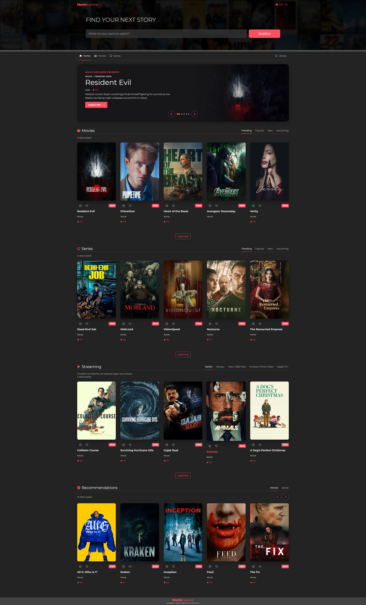
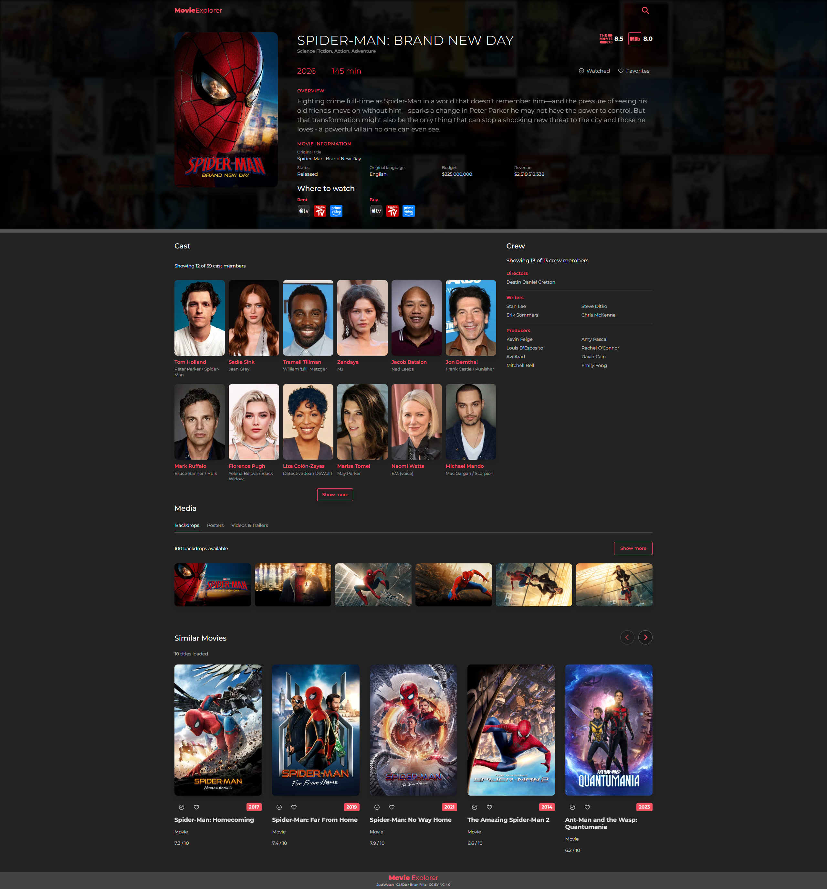

# Movie Explorer


Movie Explorer is a full-stack application for discovering and exploring movies, TV series, and people. It uses TMDB for catalog data and provides a responsive React interface backed by a NestJS API.

## Screenshots

**Discover**



**Movie Details**



## Features

- Discover movies, series, and people; search with autocomplete and filter results.
- Open movie, series, person, season, and episode details, including cast, crew, and person filmographies.
- Browse photo galleries in a zoomable lightbox, watch available videos, and explore related, similar, and recommended titles.
- View regional streaming availability and optional IMDb ratings.
- Save movies and series to a guest Library (Favorites, Watched, and Watchlist), stored in browser local storage.
- Choose English or Hungarian and a separate streaming region.
- Use responsive layouts with loading, empty, and error states.

## Technology

| Area | Stack |
| --- | --- |
| Web | React 19, TypeScript, React Router, SCSS, Vite+ |
| API | NestJS 11, TypeScript |
| Data | TMDB integration; optional OMDb ratings |
| Workspace | npm workspaces, Vite Task, shared `packages/contracts` |
| Quality | Vitest, React Testing Library, Jest, Oxlint, ESLint, Stylelint |

## Architecture

The web app calls the Movie Explorer API through its API client. NestJS controllers and services delegate catalog work to the provider boundary; the TMDB integration maps provider responses into shared application contracts. The browser never calls TMDB directly, and provider credentials stay on the API side.

## Getting started

Requirements: Node.js `>=24.11.0 <25` and npm `>=11.6.2 <12`.

```sh
npm ci
```

Copy `apps/api/.env.example` to `apps/api/.env` and set `TMDB_ACCESS_TOKEN`. `OMDB_API_KEY` is optional and enables IMDb ratings. The frontend uses `VITE_API_BASE_URL` to override its API address; see `apps/web/.env.example` for optional site metadata settings. Do not commit `.env` files.

Start both workspaces with `npm run dev`. The web app is at <http://localhost:5173>, the API at <http://localhost:4000>, and development Swagger UI at <http://localhost:4000/api-docs>.

## Development commands

Run from the repository root:

| Command | Purpose |
| --- | --- |
| `npm run dev` | Start web and API development servers |
| `npm run lint` | Lint workspaces and agent infrastructure |
| `npm run typecheck` | Type-check workspaces |
| `npm test` / `npm run coverage` | Run tests / coverage tasks |
| `npm run build` | Build workspaces |
| `npm run test:e2e` | Run mocked-provider API end-to-end tests |
| `npm run check:changed` | Verify workspaces selected from changed files |
| `npm run check:all` | Run full verification |

These workspace tasks are orchestrated by Vite Task. The API e2e suite uses a mocked provider and does not require TMDB credentials.

## Quality assurance and CI

GitHub Actions runs quality gates for static checks and security, coverage, builds, and API e2e; the aggregate `Quality Gates` check requires all lanes. See [CI workflow](.github/workflows/ci.yml). Changed-file verification is described in [agent engineering](docs/agent-engineering.md).

## Documentation

- [Web app](apps/web/README.md) and [API](apps/api/README.md)
- [Agent engineering](docs/agent-engineering.md): [AGENTS.md](AGENTS.md), skills, workflows, changed-file verification, and full verification

## Credits and attribution

Movie and people metadata, images, and videos are provided by [TMDB](https://www.themoviedb.org/). This product uses the TMDB API but is not endorsed or certified by TMDB. IMDb ratings are optional and sourced through OMDb when configured.
