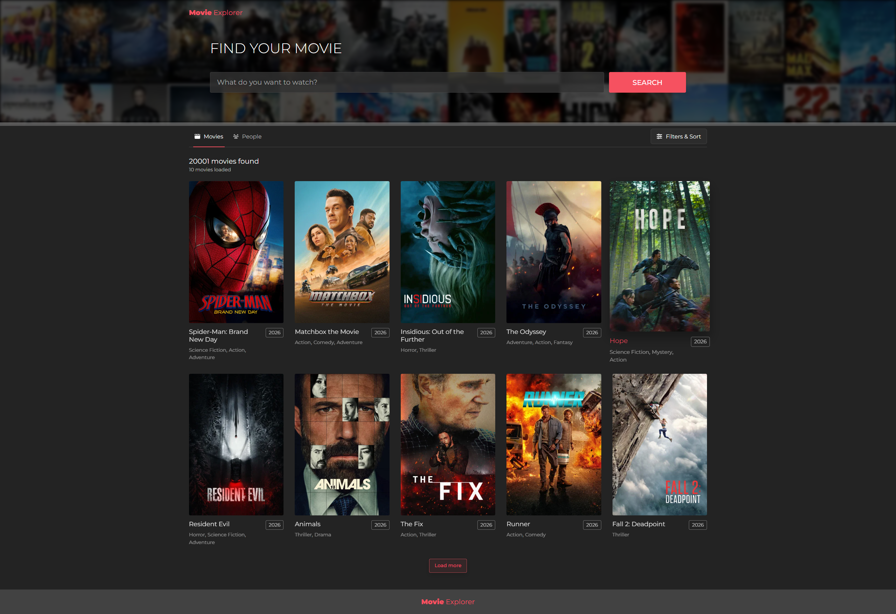

# Movie Explorer

Movie Explorer lets you search and browse movies, view details, and explore cast, photos, and videos. The React frontend uses the NestJS API for movie data so TMDB credentials stay on the server and provider responses are mapped to application contracts.

## Screenshots




## Features

- Search Movies, Series and Persons with shared keyboard accessible autocomplete on Home and detail headers.
- Switch between shareable All, Movies, Series and Persons results; filter and sort Movies, filter Series by first-air year, and load ten more results at a time.
- View movie details, cast, separate backdrops and posters, and videos.
- Open high resolution photos in a lightbox with fullscreen, zoom, pan, and touch gestures.
- Browse a responsive interface with lazy loaded thumbnails and responsive images.

## Tech stack

- React 19, TypeScript, React Router, and SCSS
- NestJS 11, class-validator, and Swagger/OpenAPI
- npm Workspaces and Vite+ with Vite Task
- Vitest and React Testing Library for frontend tests; Jest for API unit and e2e tests
- Oxlint, ESLint, Stylelint, and TypeScript checks; Oxfmt for API formatting

## Getting started

Prerequisites: Node.js 24 and npm 11.6.2 or newer. These match the Node.js major version used in CI and the package manager declared by the repository.

Install dependencies from the repository root and create the API environment file from its safe example:

```sh
npm ci
cp apps/api/.env.example apps/api/.env
```

Set `TMDB_ACCESS_TOKEN` in `apps/api/.env` to a TMDB read access token. The other `TMDB_*` settings have defaults; their available names are listed in the example. The frontend's `VITE_API_BASE_URL` defaults to `http://localhost:4000` and only needs to be set when the API runs at another address. See the [API](apps/api/.env.example) and [web](apps/web/.env.example) environment examples for variable names and safe defaults. Do not commit `.env` files or credentials.

Start the frontend and API together:

```sh
npm run dev
```

The frontend is at [http://localhost:5173](http://localhost:5173) and the API listens at [http://localhost:4000](http://localhost:4000).

## Development and checks

Run these scripts from the repository root. Vite Task coordinates the workspace tasks.

```sh
npm run dev
npm run build
npm run lint
npm run typecheck
npm test
npm run coverage
npm run test:e2e
```

The API e2e task builds the API and runs its mocked provider suite; it does not need TMDB credentials. GitHub Actions runs lint, typecheck, coverage, build, and API e2e checks on pull requests and pushes to `main`. To run one app during development, use `npm run dev --workspace @movie-explorer/web` or `npm run start:dev --workspace @movie-explorer/api`.

## API documentation

The running API serves its generated Swagger/OpenAPI documentation at [http://localhost:4000/api-docs](http://localhost:4000/api-docs). The API keeps TMDB integration details server side and returns the shared application contracts.

`GET /api/v1/persons/:id` returns a person profile and movie filmography for a positive integer TMDB person ID. It returns 400 for invalid IDs, 404 for missing persons, and 502 for invalid primary data or sanitized upstream failures; rate limits return 429 and timeouts return 504. Optional metadata is omitted when unavailable; birthdays, death dates, and release dates remain date-only strings.

Filmography merges acting and crew credits by movie ID in first-seen order (cast followed by crew), excluding explicitly adult records. `actingCredits` contains distinct character names; an empty array records acting with an unknown character, while an absent field means no acting credit. `crewCredits` contains distinct department/job pairs, with unavailable values omitted. Movie summaries use an empty poster URL for missing posters and an empty genres array because the appended credits do not supply genre names. No per-movie requests, sorting, or pagination are performed.

`GET /api/v1/persons/:id?include=combinedFilmography` opts into one combined profile request with Movie and Series credits while retaining legacy `filmography` rows. The additional `combinedFilmography` envelope contains `entries` and independent `groups.movie` / `groups.tv` availability. Entries use `mediaType: 'movie' | 'tv'` and stable `mediaType:id` identities; Series credits use `firstAirDate` (the series premiere, not person participation) and preserve role-level episode counts. Default Person responses and `/filmography` remain movie-only.

`GET /api/v1/persons/:id/combined-filmography?mediaType=all|movie|tv` recovers only requested sources; scoped responses contain only requested availability keys. Partial success survives, including successful empty collections. All failed sources return a classified error, prioritizing rate limiting. The opted-in profile uses one bounded compound request without automatic fallback.

Person Filmography uses one component and rule implementation for All, Movies and Series, then Acting/Crew/jobs and sorting. `personType=movie|tv` composes with existing `personView`, `personRole` and `personSort` URLs. Existing URLs, browser history, repeated unrelated parameters, ten-title reveal and correct Movie/Series destinations are preserved. Unavailable groups retain URL selections until recovery.

Canonical resources are `/api/v1/movies`, `/api/v1/series`, `/api/v1/persons`, and `/api/v1/search`. The former `/movies` and `/api/v1/tv` route trees have been removed and return 404. Swagger exposes only canonical operations. Movie details retain `cast` and `director` and add structured `castMembers` and `directors` with optional person IDs and responsive portraits. Person pages are available at `/person/:id`, with portraits, biographies, and filmographies.

Unified text search uses `GET /api/v1/search?query=Avatar&type=all&page=1`. `type` supports `all` (default), `movie`, `tv` and `person`. Queries are trimmed, nonempty and bounded to 100 characters; pages are integers from 1 to 500. `year` filters Movie primary release year or Series first-air year (1874-9999); All and Persons reject it. Unsupported genre, rating, sort and unknown query parameters are rejected. HTTP validation failures return 400, upstream failures 502, timeouts 504, and rate limits 429 with safe retry metadata.

The application-owned `SearchResponse` contains `results`, `page`, `totalPages` and `totalResults`. Entries discriminate on `mediaType: 'movie' | 'tv' | 'person'`; identity is always `mediaType:id`. Movies use title/releaseDate, Series title/firstAirDate and Persons name/knownForDepartment. Available images, descriptions, popularity and ratings are optional; absent metadata is omitted. Browser destinations remain `/movie/:id`, `/tv/:id` and `/person/:id`.

The API's `type=all` mode remains a single TMDB multi-search page; the grouped Search UI uses the typed modes instead. Typed searches use the matching Movie, TV or Person search endpoint. Provider relevance order and page boundaries are preserved; pages are never merged across independent searches or eagerly scanned. Total results are upstream counts before removal of unusable/adult records and deduplication; accessible pages are capped at 500. These totals are not exact renderable-card counts or a custom global popularity ranking. The UI deduplicates loaded pages by composite identity. Live upstream changes can move records between pages; no client can guarantee a frozen snapshot of TMDB search.

Unified autocomplete uses `GET /api/v1/search/suggestions?query=Avatar&limit=6&includeSeries=true`. Omitting `includeSeries` retains the existing Movie/Person response. The limit applies to each group (maximum 10); the UI displays up to six Movies, six Series and six Persons in that group/keyboard order. Three bounded parallel first-page searches preserve existing Movie/Person ranking, per-group limits and independent availability. No suggestion detail lookups are made. Shared autocomplete retains the 300ms debounce, cancellation, stale-response guards, keyboard selection and dismissal. The existing `/api/v1/movies/suggestions` remains Movie-only.

Search URLs retain `/search/:searchQuery`, default Movies, `view=people` for Persons, and `view=all` / `view=tv`. All appears only for a nonempty query; clearing All replaces its empty-query URL with Movies. Searching within a selected category preserves that category. All shows separate Movies, Series and Persons sections, with up to five cards each, category View all links, and no global pagination. Three independent first-page typed searches preserve relevance within each category. Counts labeled "available results" refer to the validated, deduplicated first-page records, not an exact total across the provider catalog. Empty groups are omitted, failures can be retried independently, and an entirely empty successful search shows one empty state.

Empty-query Movies retain existing filters, sorting and pagination. `GET /api/v1/series?page=1` browses popular Series through TMDB discover; optional `year`, `minimumRating`, `sort=popularity|firstAirDate|rating|title` and `order=asc|desc` are validated. `GET /api/v1/persons?page=1` browses popular persons; supplying `query` retains name search. These use the existing Series and Movie/Person provider boundaries. Category listings reveal ten cards at a time and retain normal pagination with the shared coral outline Load more variant.

Series text search supports relevance and first-air year; default Series browsing additionally supports minimum rating and sorting. The existing Filter panel hides inapplicable controls. Movie genre selections remain dormant in other categories, and Movie rating selections remain dormant during Series text search. The shared `year` parameter means release year for Movies and first-air year for Series and is inactive in All/Persons. Existing Movie text search keeps its page-level genre/rating filtering and count semantics.

The existing `/api/v1/persons?query=Weaver&page=1` and Movie list APIs remain compatible. Search normalization uses replace before mounting request owners; user changes push history. Queries, views and effective filters restore through direct links and Back/Forward. Ten-item reveal, loaded pages and scroll positions are retained in the existing bounded in-memory history cache for each history entry, including Series detail return; reveal depth is not persisted across reloads. Stale requests are aborted/ignored and failed next pages retry without advancing. Browser cancellation protects UI state; inbound HTTP disconnects do not cancel backend TMDB work.

### Series, seasons and episodes

- `GET /api/v1/series`: paginated default Series listing (see above).
- `GET /api/v1/series/:id`: series metadata, creators, networks, actual season summaries (including Specials), aggregate credits, images and videos in one bounded upstream request. Optional sections have independent availability.
- `GET /api/v1/series/:id/credits`: whole-series aggregate cast/crew, multiple character/job credit records, supplied per-role and total episode counts (never summed), and independent cast/crew availability.
- `GET /api/v1/series/:id/images`: posters/backdrops with independent availability, thumbnail/original URLs, dimensions, aspect ratios and language.
- `GET /api/v1/series/:id/videos`: video identifiers, providers, types, languages, optional published dates and availability.
- `GET /api/v1/series/:id/seasons/:seasonNumber`: season metadata and ordered episode summaries. `episodeCount` is the number of returned records, not an advertised schedule total.
- `GET /api/v1/series/:id/seasons/:seasonNumber/episodes/:episodeNumber`: episode metadata and independently available cast, guest stars and crew.
- `GET /api/v1/series/:id/seasons/:seasonNumber/episodes/:episodeNumber/credits`: explicit episode credit recovery. Successful empty categories differ from unavailable categories.

Season and Episode pages reuse the Series hero, shared image viewer, metadata, section styling, and recovery components. Season posters use the parent Series backdrop where available. Episode stills include optional `stillSrcSet` candidates: smaller page images and an original loaded on demand in the lightbox. Cast and guest stars use the existing bounded cast-card preview; sparse neighboring episode navigation uses returned season records.

IDs and episode numbers are decimal safe integers from 1; season numbers start at 0. Invalid coordinates return 400; valid but missing resources return 404. Unknown series metadata uses null or empty collections. Season and episode numbers are preserved, with no filled gaps. Episode details append credits in one upstream request, preserving usable base guest/crew data. There is no automatic compound-request fallback; manual recovery has its own bounded request deadline. Series and season requests never fetch every child detail.

Application-owned modules, adapters, contracts and UI helpers use Series naming (Season and Episode where unambiguous). The stable wire discriminator `mediaType: 'tv'` and existing `tv:id` identities are preserved; TMDB paths and payloads keep their official `tv` terminology.

Frontend routes are `/tv/:id`, `/tv/:id/seasons/:seasonNumber`, and `/tv/:id/seasons/:seasonNumber/episodes/:episodeNumber`. Named seasons and Specials link to vertical episode lists. Previous/next links use actual current-season records; direct episode URLs load season context concurrently. Optional context failures leave primary details usable. Series Details reuses the cast preview, progressive media galleries and photo/video lightboxes. Cast, crew and media have bounded previews and local Show More controls. Standalone recovery only requests the failed resource. Series search, saved collections and recommendations remain deferred.

## Request failures and deadlines

Browser API requests have a 12-second deadline, including JSON body reads. All existing request types use this default. Caller cancellation remains independent and silent in existing navigation/search flows; timeouts remain genuine failures eligible for manual retry. There are no automatic retry loops; detail requests have the bounded fallback described below. The API utility exposes typed categories (`invalid-request`, `not-found`, `rate-limited`, `internal-server`, `service-unavailable`, `http`, `network`, `timeout`, `cancelled`, `invalid-response`), retains available HTTP status, and keeps `isNotFoundError` compatibility. Rate-limit errors retain validated header delays as `retryAfterSeconds`. Invalid JSON is classified; Series responses receive runtime identity, coordinate, nested structure, nullability and availability validation. Legacy responses retain their existing validation.

TMDB requests default to 8 seconds, including body reads. Set `TMDB_REQUEST_TIMEOUT_MS` to decimal integer milliseconds from 1 to 60000; invalid configuration fails startup. Keep it below the browser deadline where practical. Each upstream request has its own deadline, so sequential provider calls can exceed one upstream deadline.

- Missing movie/person details return 404. Unexpected collection/search/genre 404 responses return 502; successful empty collections remain valid.
- Upstream 429 returns 429. A positive `Retry-After` delay up to 24 hours, supplied as integer seconds or a canonical future HTTP date, is normalized to seconds in the `Retry-After` response header and optional `retryAfter` body field. Invalid, expired, zero, or longer delays are omitted. CORS exposes this header.
- Upstream timeout returns 504. Connection failures, invalid JSON/required response structures, upstream authorization failures, and other upstream HTTP failures (including 5xx) return sanitized 502 responses. Missing credentials or invalid configuration prevent startup.
- Public errors retain Nest's `statusCode`, safe `message`, and standard `error` label where provided; validation messages remain arrays. Expected upstream failures log operation category, failure category, upstream status when known, and application status without raw messages, query text, credentials, or bodies.

Both detail route IDs accept decimal digits only, a positive integer at most `Number.MAX_SAFE_INTEGER`; leading zeroes are allowed. Scientific/hexadecimal notation, signs, fractions, whitespace, zero, and unsafe integers are rejected. The frontend shows a contextual invalid-ID state without fetching; the API returns 400. Valid missing IDs remain 404.

Error response types remain outside the shared success contracts; a shared error contract and schema migration are deferred. Detail errors use the shared contextual popcorn presentation, with safe messages for classified API failures. Invalid IDs and missing resources offer Back to Search without Retry. Recoverable failures offer a guarded manual Retry; validated rate-limit delays provide guidance without timers or automatic requests. Pending retries keep the action focused; success moves focus to the detail main landmark only when that action still holds focus. Cancellation stays silent. Search failures remain inline and pagination failures retain loaded results. Autocomplete failures are visible beside the input and Enter still submits the query.

Back to Search returns to the preceding search entry only when the app observed that Search-to-Detail push in the current session. This reuses bounded result and scroll snapshots, preserving query, view, filters, sorting and loaded depth. Direct entries, reloads, evicted history and detail-to-detail navigation fall back to `/search`; no persistent search storage or speculative history jumps are used. Fatal rendering errors retain full-document Reload and a native Search link, independent of router context, without resetting the failing tree or displaying an HTTP status.

### Partial details and independent autocomplete (Phase 24.3C)

The public response behavior is summarized below.

Detail responses include optional availability metadata:
- Movie: `sections.credits`, `sections.photos` (backdrops), `sections.posters`, `sections.videos`.
- Person: `filmographyAvailability`.
- Unified autocomplete: `groups.movie` and `groups.person`.

Each state is `{ status: 'available' }` (including successfully empty data) or
`{ status: 'unavailable', retryAfterSeconds?: number }`. Unavailable data must
never be interpreted as a successful empty section. Metadata is optional in the
TypeScript contracts to accept older successful responses; the current provider
always supplies it. Older clients can still read the existing data fields, but
need updating to distinguish unavailable sections.

Movie details retain one TMDB request with appended credits, images and videos;
person details retain one request with appended movie credits. Missing, failed or
malformed appends are isolated without additional requests. If that request fails
atomically with an eligible 502 (HTTP/connection failure), one profile-only request
can salvage the required record. Invalid JSON, invalid primary data, 404, 429 and
504 do not trigger fallback. No timeout defaults change. Sequential fallback may
still exceed the browser deadline on a slow upstream; cancellation remains silent.
There are no recommendations or independent person photo sections.

Manual recovery endpoints return only the mapped section:
- `GET /api/v1/movies/:id/credits`: cast and crew fields.
- `GET /api/v1/movies/:id/photos`: `{ backdrops: [...] }` (the existing photo recovery route).
- `GET /api/v1/movies/:id/posters`: `{ posters: [...] }`.
- `GET /api/v1/movies/:id/videos`: `{ videos: [...] }`.
- `GET /api/v1/persons/:id/filmography`: `{ filmography: [...] }`.

Movie details expose complete `backdrops`, `posters`, and `videos` collections,
with six backdrop previews, ten portrait poster previews, and four video cards.
Gallery buttons open the selected image category in the existing lightbox or
expand video cards. Originals load only when opened; embeds are created only
after selection and do not autoplay. Images preserve file paths, dimensions,
aspect ratios and language; videos preserve identifiers, site, type and language.
TMDB requests retain `TMDB_LANGUAGE` (default `en-US`) and explicitly include its
language, English, and untagged media through `include_image_language` and
`include_video_language`, both for appends and recovery. Other localized variants
are intentionally excluded. YouTube uses the existing player, Vimeo opens an
external link, and unknown video sites show an unavailable-playback message.
Logos are not exposed. Movie image responses now use `backdrops` in place of
`photos`; the frontend also accepts older responses using `photos`, including
recovery responses.

These endpoints validate IDs and preserve sanitized 429/502/504 behavior and safe
Retry-After headers. Retry affects only the selected section, guards pending
requests, and cancels/ignores obsolete work. Successful sections, media controls,
biography state and filmography URL controls remain intact. Local states have
section headings, loading feedback, explicit empty text, and compact unavailable
messages. After recovery, focus moves to the surviving local status only if the
retry control still held focus, without scrolling.

Unified autocomplete independently settles movie/person searches while retaining
provider ordering within each group. Partial results stay selectable, with subtle
unavailable feedback. A successful empty group alongside failure does not claim
that no suggestions exist. Both failures preserve existing classified error UX.
Enter still submits a search.

The frontend validates new availability discriminants, required section fields,
recovered section content, and partial suggestion structures at the API boundary.
Broader validation of legacy successful JSON and a shared error schema remain
separate follow-ups. The intentional white-on-coral contrast exception remains;
this feature does not claim complete WCAG AA compliance.

## Project structure

```text
apps/
  api/                 NestJS API and TMDB integration
    src/movies/        Movie endpoints and application logic
    src/persons/       Person endpoint, DTOs, and application logic
    src/integrations/  External provider integrations
    test/              API end-to-end tests
  web/                 React frontend
    src/components/    Search, filters, movie cards, and details
    src/pages/         Application pages
    src/util/          Frontend API client and utilities
packages/
  contracts/           Shared TypeScript API contracts
```
